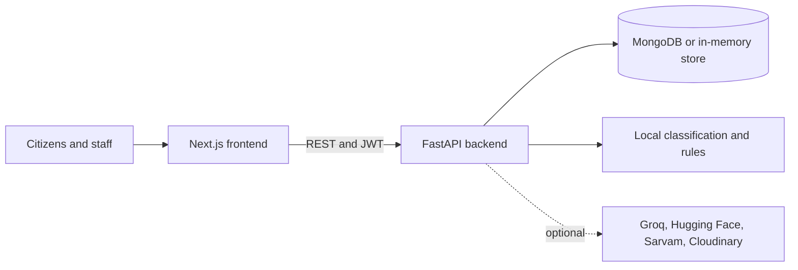

# SAMARTH

**System for Accessible Management, Action, Resolution and Tracking of Hearings**

SAMARTH is a B.Tech academic research prototype for managing civic grievances.
It combines a citizen-facing complaint portal with role-based staff workflows,
department analytics, and experimental AI-assisted triage. It is a prototype,
not an official government service or a national grievance platform.

AI outputs are advisory. Authorized people make the final decisions about
department routing, employee assignment, escalation, resolution approval, and
closure.

## What the system supports

| Role | Main capabilities |
|---|---|
| Citizen (`USER`) | Register and sign in; submit a complaint with a location and optional attachments; track personal complaints; receive in-app updates. |
| Global administrator (`ADMIN`, without a department) | Review and route grievances, oversee queues, view analytics and maps, and manage platform work. |
| Department manager (`ADMIN`, with a department) | Work within the assigned department, allocate its grievances to employees, and manage department employee accounts. |
| Employee (`RESOLVER`) | View assigned work, acknowledge and progress tasks, add updates, raise issues, and submit work for manager review. |
| System administrator (`SUPERADMIN`) | Manage accounts, roles, departments, and system-level administration. |

The grievance workflow includes submission, classification, human department
review, employee assignment, progress updates, escalation, resolution review,
and closure. A manager assigns employees; the platform does not assign
employees autonomously.

### Main features

- Complaint registration requires a signed-in citizen. The form supports a
  self-location and an optional incident location, a map picker, and optional
  image evidence.
- Citizens can see their grievance status, activity timeline, and in-app
  notifications. Staff receive assignment and workflow notifications.
- Global and department-scoped staff workspaces provide grievance queues,
  employee allocation, and department-specific analytics. Administrators also
  have location maps with complaint clustering.
- Employee workspaces include assigned-task queues, task progress updates,
  issue escalation, and resolution submission for manager review.
- The citizen UI currently offers English, Hindi, and Marathi. Eight additional
  language packs are present in the source but are not offered in the language
  picker; native-language review is still needed.
- Voice-assisted complaint drafting is available behind a backend feature
  flag. Transcription is disabled by default. Citizens review and edit the
  transcript before submitting a complaint.

## Technology

| Layer | Technology |
|---|---|
| Frontend | Next.js 16 App Router, React 19, TypeScript, Tailwind CSS 4 |
| Backend | Python 3.11+, FastAPI, Pydantic, Uvicorn |
| Persistence | MongoDB through PyMongo; process-local in-memory fallback when `MONGODB_URI` is empty |
| Authentication | JWT sessions and server-side role checks; Google OAuth is optional |
| Mapping and charts | Leaflet and Recharts |
| AI and text analysis | Local scikit-learn classification and keyword rules; optional Hugging Face and Groq provider fallbacks |
| Optional services | Cloudinary uploads, Sarvam speech-to-text, face authentication, and Twilio SMS |

The frontend calls the FastAPI REST API. AI and classification services run
inside the backend; there is no separate AI microservice.



## Repository map

```text
backend/app/       FastAPI application, routers, repositories, and services
backend/data/      Research and evaluation datasets
backend/           Demo data seeder, evaluation utilities, and runtime requirements
frontend/app/      Next.js pages and role workspaces
frontend/components/ Shared UI, grievance, admin, resolver, and chart components
frontend/lib/      API client, auth session, types, i18n, and workflow utilities
frontend/public/   Static assets, including demo grievance images and voice prompts
tests/             Backend API, RBAC, repository, AI, and feature tests
tools/             Data maintenance utilities
docs/              Architecture, API, database, security, workflow, and AI guides
memory/            Project state, decisions, and agent handoff history
```

## Requirements

- Python 3.11 or newer
- Node.js 20 or newer and npm
- MongoDB 7 or a MongoDB Atlas database for persistent local data (optional for
  a quick in-memory run)

## Run locally

Use two terminals from the repository root.

### 1. Configure and start the backend

Create a Python environment and install the backend dependencies:

```bash
python -m venv .venv
# macOS or Linux
source .venv/bin/activate
# Windows PowerShell: .venv\Scripts\Activate.ps1

python -m pip install -r backend/requirements.txt
```

Create the local backend configuration:

```bash
cp backend/.env.example backend/.env
# Windows PowerShell: Copy-Item backend/.env.example backend/.env
```

Set a private signing key in `backend/.env`. For local development, generate
one with:

```bash
python -c "import secrets; print(secrets.token_hex(32))"
```

Set `JWT_SECRET_KEY` to the generated value. To persist data across backend
restarts, also set `MONGODB_URI` to a local or sandbox MongoDB connection string
and keep `MONGODB_DB=grievance`. If `MONGODB_URI` is empty, the API uses
in-memory repositories and all data is lost when the backend process stops.

For an isolated local demonstration, the following settings seed the default
admin and the department manager/employee accounts:

```dotenv
SEED_ADMIN_EMAIL=admin@grievance.local
SEED_ADMIN_PASSWORD=Admin@2026!
SEED_TEST_ACCOUNTS=true
```

`citizen@grievance.local` is seeded automatically. Test accounts are created
only if missing; existing accounts and their passwords are left unchanged.
Keep account seeding disabled on public or production deployments.

Start the API from the repository root:

```bash
python -m uvicorn backend.app.main:app --reload --host 127.0.0.1 --port 10000
```

The API runs at `http://127.0.0.1:10000`. Interactive API documentation is at
`http://127.0.0.1:10000/docs`; the health endpoint is
`http://127.0.0.1:10000/health`.

### 2. Configure and start the frontend

In the second terminal:

```bash
cd frontend
npm ci
```

Create `frontend/.env.local` from the example:

```bash
cp .env.example .env.local
# Windows PowerShell: Copy-Item .env.example .env.local
```

Set these values for the local API and seeded demo accounts:

```dotenv
NEXT_PUBLIC_API_URL=http://localhost:10000
NEXT_PUBLIC_USE_MOCKS=false
NEXT_PUBLIC_SHOW_DEV_CREDS=true
```

`NEXT_PUBLIC_USE_MOCKS` defaults to `true` in the example file. Set it to
`false` to use the FastAPI backend and its database. The development credential
panel is for isolated evaluation only; never enable it in a public deployment.

Start the frontend:

```bash
npm run dev
```

Open `http://localhost:3000`. Restart the frontend after changing any
`NEXT_PUBLIC_*` setting.

### Useful routes

| Route | Purpose |
|---|---|
| `/` | Public home and dashboard |
| `/login` and `/register` | Sign in and citizen account registration |
| `/submit` | Authenticated citizen complaint form |
| `/track` | Signed-in citizen grievance tracking |
| `/notifications` | Account notification inbox |
| `/admin` | Administrator overview and grievance queue |
| `/admin/employees` | Department employee accounts and task allocation |
| `/admin/analytics` | Role-scoped analytics and map |
| `/resolver` | Employee assigned-task workspace |
| `/superadmin` | System account and department administration |
| `/profile` | Citizen account profile |

## Demo accounts

The following default credentials are for an isolated demo database only.
Change them and disable development credential display before exposing an
instance publicly.

| Account | Email | Default password |
|---|---|---|
| Citizen | `citizen@grievance.local` | `Citizen@2026!` |
| Global admin | `admin@grievance.local` | `Admin@2026!` |
| Superadmin | `superadmin@grievance.local` | `SuperAdmin@2026!` |
| Department manager | `<department>.manager@grievance.local` | `Manager@2026!` |
| Department employee | `<department>.employee@grievance.local` | `Resolver@2026!` |

Department account keys are `water`, `roads`, `transport`, `electricity`,
`sanitation`, `health`, `governance`, and `other`. Roads and transport share a
department in the user interface; their seeded accounts remain separate test
identities. `SEED_TEST_PASSWORD`, when configured, overrides manager and
employee defaults.

The current shared evaluation database snapshot (2026-10-23) contains 19
default demo accounts and 28 plausible civic complaints. These counts can
change as the demonstration proceeds. The demo seed command below adds up to
eight curated records; do not run it against the shared evaluation database
unless those extra records are wanted.

## Optional curated demo data

`backend/seed_demo_data.py` contains eight geolocated examples across water,
roads, transport, electricity, sanitation, health, governance, and other civic
services. Their image files are included in `frontend/public/demo-assets/`.

Run the seeder from the repository root against a disposable local MongoDB:

```bash
python -m backend.seed_demo_data
```

The command is idempotent for records it has already seeded. Do not use the
in-memory fallback with this separate command: its data disappears when the
seeder process exits. For a hosted frontend, set `DEMO_IMAGE_BASE_URL` to that
frontend's `/demo-assets` URL before seeding. Do not point the seeder at a
production or shared evaluation database unless adding these records is
intentional.

## Optional integrations

Most core workflows run without external AI services. Configure optional keys
in `backend/.env` only when testing the corresponding feature:

| Setting | Purpose | Default behavior |
|---|---|---|
| `GROQ_API_KEY` | Optional classification and quality-check fallback | Local rules/classifier remain available without it |
| `HF_API_TOKEN` | Optional Hugging Face classification fallback | Not required for startup |
| `CLOUDINARY_CLOUD_NAME`, `CLOUDINARY_API_KEY`, `CLOUDINARY_API_SECRET` | Image upload and management | Attachments require the configured upload path |
| `TRANSCRIPTION_ENABLED`, `SARVAM_API_KEY` | Voice transcription | Disabled by default; requires explicit provider configuration |
| `FACE_AUTH_ENABLED`, `FACE_EMBED_KEY` | Optional face sign-in | Disabled by default; also requires `backend/requirements-face.txt` and model setup |
| `GOOGLE_CLIENT_ID`, `GOOGLE_CLIENT_SECRET` | Google OAuth | Google sign-in is unavailable until configured |
| `SMS_PROVIDER` and `TWILIO_*` | SMS notifications | Dry-run/off unless configured |

Never put provider secrets in frontend `NEXT_PUBLIC_*` variables or commit them
to source control. See [backend/.env.example](backend/.env.example) and
[frontend/.env.example](frontend/.env.example) for additional settings.

## Tests and quality checks

From the repository root:

```bash
# Backend tests. MongoDB-specific tests skip unless TEST_MONGODB_URI is set.
python -m pytest

# Frontend lint and production build
npm --prefix frontend run lint
npm --prefix frontend run build

# Frontend voice unit and UI tests
npm --prefix frontend run test:voice

# Frontend/API contract checks
node frontend/scripts/check-contract.mjs
```

The backend test fixtures disable external API calls and use fresh in-memory
repositories. For MongoDB repository tests, set `TEST_MONGODB_URI` and
`TEST_MONGODB_DB` to a disposable test database. Do not point test fixtures at
the evaluation or production database.

`docs/USER_SIDE_TEST_CASES.md` is a manual test plan. Its cases are not a
record of executed tests; check the current status before treating the plan as
validation evidence.

## AI status and known limitations

- Category classification is a prototype cascade using a local
  word/character model, deterministic rules, and optional provider fallbacks.
  It is experimental and must not be treated as validated accuracy.
- Priority and urgency values are advisory. A human reviews department routing
  and assigns employees.
- Related-complaint grouping uses client-side TF-IDF; semantic embedding search
  is not implemented.
- Several planned research modules, including persisted summarization, entity
  extraction, delay-risk estimation, AI escalation recommendations, and
  resolution-quality assessment, are not complete. See
  [Current project state](memory/CURRENT_STATE.md) for the implementation
  status and remaining work.
- The application is an academic prototype. It has not been approved or
  validated for real government operations or production-scale use.

## Deployment

`render.yaml` defines the FastAPI backend service. Deploy the Next.js frontend
separately and configure its `NEXT_PUBLIC_API_URL` to the deployed backend.
Configure MongoDB, a strong `JWT_SECRET_KEY`, exact `CORS_ORIGINS`, and
`FRONTEND_URL` in the hosting provider's secret/environment settings. Keep
`SEED_TEST_ACCOUNTS=false` and `NEXT_PUBLIC_SHOW_DEV_CREDS=false` for any public
deployment. Review the deployment-specific flags in `render.yaml`; provider
credentials must be configured in the hosting dashboard, not committed to the
repository.

## Further documentation

- [Product requirements](PRD.md)
- [Project and research context](docs/PROJECT_CONTEXT.md)
- [Architecture](docs/ARCHITECTURE.md)
- [API contracts](docs/API.md)
- [Database design](docs/DATABASE.md)
- [Grievance workflows](docs/WORKFLOWS.md)
- [AI system and limitations](docs/AI_SYSTEM.md)
- [Security notes](docs/SECURITY.md)
- [Local development guide](docs/DEVELOPMENT.md)
- [Voice-assisted complaint guide](docs/VOICE_ASSISTED_COMPLAINT.md)
- [Current project state and remaining work](memory/CURRENT_STATE.md)
